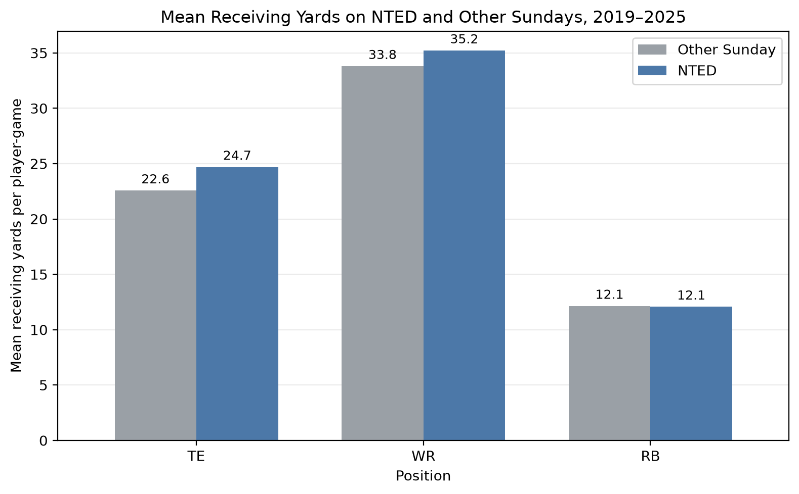

## Does the holiday show up in the stats?

National Tight Ends Day (NTED) is celebrated by the NFL on the fourth Sunday in October. Broadcasts highlight the position, but does the day correspond with different results on the field? My motivating question is: **Do NFL tight ends perform better on NTED than on other Sundays, and is any difference specific to tight ends or also visible among wide receivers and running backs?**

This is an interesting data problem because the answer is not stored in one ready-made table. Player statistics contain the performance measures, schedules contain game dates, and NTED must be calculated from a calendar rule. Combining them produces an original dataset that can support a fuller analysis later.

## Getting the data responsibly

I used [nflverse](https://github.com/nflverse), a community project that publishes NFL datasets, through its Python package [nflreadpy](https://nflreadpy.nflverse.com/api/load_functions/). The project covers the 2019–2025 seasons and uses weekly player statistics plus game schedules.

This access method avoids scraping NFL web pages. `nflreadpy` downloads the published data files in a few batch requests, so there is no need for rapid repeated requests, a private API key, or collection of personal information. At the time of access, the package used the MIT License and the nflverse data repository identified the data under [Creative Commons Attribution 4.0](https://github.com/nflverse/nflverse-data/blob/main/LICENSE.md). That license permits reuse with attribution. I credited nflverse and would check the applicable release terms again before publishing the cleaned data.

Someone starting a similar project can install `nflreadpy` and request several seasons at once:

``` python
import nflreadpy as nfl

seasons = list(range(2019, 2026))
player_stats = nfl.load_player_stats(
    seasons, summary_level="week"
).to_pandas()
schedules = nfl.load_schedules(seasons).to_pandas()
```

The download returned 129,812 player-stat rows and 1,960 schedule rows. It also reproduced my proposal's 2025 feasibility results: 19,422 player rows with 150 columns and 285 schedule rows with 46 columns.

## From two tables to one useful dataset

The full acquisition process has five main steps:

1.  Check that each schedule `game_id` is unique.
2.  Join the many player rows for a game to its one schedule row using `game_id`.
3.  Keep regular-season TE, WR, and RB observations.
4.  Calculate each season's fourth Sunday in October and flag games played on that exact date.
5.  Create opportunity features and save the result as Parquet.

The join was set to `validate="many_to_one"` so pandas would stop if the schedule unexpectedly contained duplicate game IDs. All 129,812 player rows matched a schedule record, with no disagreements in season or week.

Using the actual date is important because NTED does not always fall in the same NFL week. The dates ranged from October 22 to October 27 across the seven seasons. There were 84 games on the seven NTED dates; bye weeks explain why the number of games changes by year.

Two constructed features make the dataset more useful. First, team TE target share divides targets to tight ends by targets to all players on that team. It is calculated before the position filter so the denominator does not leave out targets to other positions. A zero denominator would become missing rather than producing an invalid value.

Second, player-season baselines summarize a player's targets, receptions, receiving yards, touchdowns, and carries in earlier appearances that season. The current game is excluded from its own baseline. A first appearance has no previous information, so those baseline values remain missing instead of being changed to zero.

## What the final dataset contains

The analysis-ready file has **35,840 player-game observations and 34 variables**, comfortably above the assignment minimum of 200 observations and five variables. It contains identifiers, dates, teams, position, targets, receptions, receiving yards and touchdowns, carries and rushing production, NTED flags, team target share, and prior player-season averages.

| Position | Player-game observations |
|:--------:|-------------------------:|
|    TE    |                    8,377 |
|    WR    |                   16,859 |
|    RB    |                   10,604 |

Validation found no duplicate player-team-game rows, missing key identifiers, unmatched schedule records, or zero target denominators. The seven retained box-score variables also had no missing values. The 3,634 missing baseline rows are expected first appearances, not data errors.

The cleaned table is stored as Parquet because it preserves types and compresses the file to about 0.6 MB. A separate JSON file records the validation results, making the reported totals auditable.

## A first look at NTED

The most noticeable descriptive result is that tight ends averaged **24.7 receiving yards on NTED versus 22.6 on other Sundays**, an increase of about 2.1 yards per player-game. However, wide receivers also increased from 33.8 to 35.2 yards, while running backs were nearly unchanged.

{fig-alt="A grouped bar chart of mean receiving yards for tight ends, wide receivers, and running backs. Tight ends and wide receivers have slightly taller National Tight Ends Day bars, while the running back bars are nearly equal."}

Targets tell a less celebratory story. Tight ends averaged 3.06 targets on NTED and 3.12 on other Sundays, even though their receptions, yards, and touchdowns were slightly higher. The measures do not all move together, and wide receivers show a similar yardage pattern, so the early evidence does not show a clear TE-only effect.

These are descriptive averages, not proof that the holiday changes performance. There are only seven NTED dates, teams have bye weeks, and player-games differ in injuries, opponents, snaps, and roles. Inactive players may not appear at all. Comparisons with surrounding weeks, prior player baselines, and other positions can provide context, but this observational dataset cannot establish causality.

## Resources and next steps

The [nflreadpy loading guide](https://nflreadpy.nflverse.com/api/load_functions/) documents other available NFL tables, while the [nflverse organization](https://github.com/nflverse) provides source details and data updates. The next analysis can compare NTED with surrounding weeks and use the baseline and team-share features to account for differences in opportunity.

The complete [acquisition code, documentation, tests, and cleaned dataset are available in a separate GitHub repository](https://github.com/jackson-justice/nfl-nted-data).