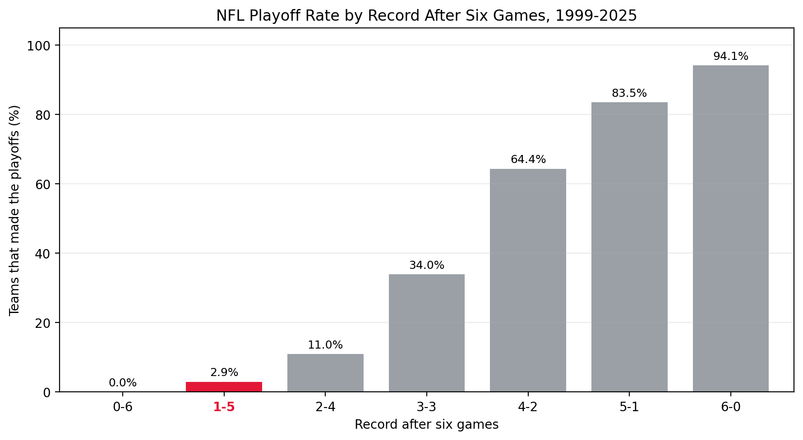

## Why look for rare outcomes?

I personally like finding rare events in datasets because they can make for interesting stories. They can also point to observations worth investigating, and that investigation can reveal a bigger picture in the data. A rare negative outcome might show us something to avoid, while a rare positive outcome can show us what went unusually well.

In this tutorial, we will use NFL data from 1999 through 2025 to search for teams that made the playoffs after a bad start. I expected fewer than 5% of teams that started 1-5 to recover. The actual rate was 2.9%, and one of those teams was the 2015 Kansas City Chiefs. After beginning 1-5, Kansas City won its final ten regular-season games and finished 11-5.

By the end, you will be able to use pandas to group outcomes, calculate event rates, and trace a rare result back to the observations that produced it.

## Load and inspect the data

The [dataset](https://github.com/jackson-justice/statigami/tree/main/nfl-championship-trajectories) contains one row for each NFL team after each week of a season from 1999 through 2025. Each row shows the team's record at that point and whether it eventually made the playoffs. We will start by importing pandas, reading the CSV file, and looking at the columns that matter most for this tutorial.

``` python
import pandas as pd

games = pd.read_csv("data/team_week_records.csv")

games[[
    "season", "team", "games_played", "record", "made_playoffs"
]].head()
```

Here is what those five columns represent:

| Column          | Meaning                                          |
|-----------------|--------------------------------------------------|
| `season`        | The year the season began                        |
| `team`          | The team's abbreviation                          |
| `games_played`  | The number of games the team had actually played |
| `record`        | The team's wins and losses at that point         |
| `made_playoffs` | `True` if the team made the playoffs that season |

We use `games_played` instead of the NFL week number because teams have bye weeks, meaning they get a week off and do not play a game. For example, a team in Week 7 may have played only six games. Using the number of games played lets us compare teams at the same point in their seasons.

## Select the checkpoints

Instead of looking at every point in the season, we will compare records after 2, 4, 6, and 8 games. These checkpoints let us see how a poor start becomes harder to overcome as the season continues without making the analysis too long.

``` python
checkpoints = [2, 4, 6, 8]

checkpoint_games = games.loc[
    games["games_played"].isin(checkpoints)
].copy()

checkpoint_games = checkpoint_games.sort_values([
    "season", "team", "week"
])

checkpoint_games = checkpoint_games.drop_duplicates([
    "season", "team", "games_played"
])
```

The `.isin()` method keeps only rows where `games_played` matches one of our four checkpoints. We then sort the rows and use `drop_duplicates()` so that each team appears only once at each checkpoint in each season. This matters because a bye week can create another row for a team even though its number of games played has not changed. Including `season` prevents records from different years for the same team from being treated as duplicates.

## Calculate playoff rates by record

Next, we group teams that had the same record at the same checkpoint. The `groupby()` columns define each group, while `.agg()` creates two new summaries. `team_seasons` counts how many teams had that record, and `playoff_teams` counts how many of them made the playoffs.

``` python
record_summary = checkpoint_games.groupby([
    "games_played", "wins", "losses", "ties", "record"
]).agg(
    team_seasons=("team", "count"),
    playoff_teams=("made_playoffs", "sum")
).reset_index()

record_summary["playoff_rate"] = (
    record_summary["playoff_teams"]
    / record_summary["team_seasons"]
)
```

This works because `made_playoffs` contains Boolean values: `True` is counted as 1 and `False` as 0 when the column is summed. A team in a different season counts as a separate observation, which is why we call the denominator `team_seasons`. The calculation is:

$$
\text{Playoff rate} = \frac{\text{playoff teams}}{\text{team-seasons with that record}}
$$

Finally, `.reset_index()` turns the grouping columns back into regular columns so we can filter and sort the results in the next step.

## Find the rare playoff paths

Before searching for the worst starts, we keep only records where at least one team eventually made the playoffs. Without this filter, winless records such as 0-4, 0-6, and 0-8 would come first even though no teams recovered from them. Our goal is not just to find bad starts; it is to find unlikely recoveries.

``` python
successful_starts = record_summary.loc[
    record_summary["playoff_teams"] > 0
].copy()

rare_paths = (
    successful_starts
    .sort_values(
        ["games_played", "wins", "losses"],
        ascending=[True, True, False]
    )
    .groupby("games_played")
    .head(1)
)

rare_paths[[
    "games_played",
    "record",
    "team_seasons",
    "playoff_teams",
    "playoff_rate"
]]
```

The `sort_values()` step puts the fewest wins and most losses first within each checkpoint. We then group by `games_played`, and `.head(1)` keeps the first row in each group. Shown as percentages, the result is:

| Games played | Worst start followed by a playoff appearance | Team-seasons | Playoff teams | Playoff rate |
|--------------:|:-------------:|--------------:|--------------:|--------------:|
| 2 | 0-2 | 227 | 25 | 11.0% |
| 4 | 1-3 | 194 | 26 | 13.4% |
| 6 | 1-5 | 102 | 3 | 2.9% |
| 8 | 2-6 | 114 | 2 | 1.8% |

The six-game result stood out to me. Only 3 of the 102 teams that began 1-5 made the playoffs, giving a rate of 2.9%. That was even lower than my original guess of under 5%.

## Investigate the 1-5 teams

Once we find a rare result, the next step is to return to the original observations and see which teams produced it. The conditions below select teams after six games, keep only 1-5 records, and require `made_playoffs` to be `True`. We also select the final wins and losses so we can compare how each season ended.

``` python
one_five_teams = checkpoint_games.loc[
    (checkpoint_games["games_played"] == 6)
    & (checkpoint_games["record"] == "1-5")
    & checkpoint_games["made_playoffs"],
    ["season", "team", "record", "final_wins", "final_losses"]
]

one_five_teams.sort_values("season")
```

| Season | Team | Six-game record | Final record |
|-------:|:----:|:---------------:|:------------:|
|   2015 |  KC  |       1-5       |     11-5     |
|   2018 | IND  |       1-5       |     10-6     |
|   2020 | WAS  |       1-5       |     7-9      |

Kansas City stands out because it won every remaining regular-season game. According to the [Kansas City Chiefs' account of the season](https://www.chiefs.com/news/andy-reid-named-101-awards-afc-coach-of-the-year-16897771), they became the first NFL team to start 1-5, finish on a ten-game winning streak, and make the playoffs.

To me, the timing makes the result even more interesting. Andy Reid had become the Chiefs' head coach in 2013, and this comeback came one season before Kansas City began winning consecutive AFC West titles. Patrick Mahomes later became the full-time starting quarterback in 2018. Looking back, the 2015 season feels less like an isolated strange result and more like an early sign of the franchise's future success.

## Visualize the six-game checkpoint

A graph makes the 1-5 result easier to compare with the other records after six games. We first keep the six-game checkpoint and remove tied records from this graph to make the labels easier to read. The tied records were still included in the earlier analysis.

``` python
six_game_summary = record_summary.loc[
    (record_summary["games_played"] == 6)
    & (record_summary["ties"] == 0)
].sort_values("wins").copy()

six_game_summary["playoff_rate_percent"] = (
    six_game_summary["playoff_rate"] * 100
)

bar_colors = [
    "#E31837" if record == "1-5" else "#9AA0A6"
    for record in six_game_summary["record"]
]

playoff_chart = six_game_summary.plot.bar(
    x="record",
    y="playoff_rate_percent",
    color=bar_colors,
    legend=False
)

playoff_chart.set_title(
    "NFL Playoff Rate by Record After Six Games, 1999-2025"
)
playoff_chart.set_xlabel("Record after six games")
playoff_chart.set_ylabel("Teams that made the playoffs (%)")
```

The playoff rates are multiplied by 100 so the vertical axis displays percentages. The color list makes the 1-5 bar red and every other bar gray. Finally, pandas uses Matplotlib to create the bar chart and add the title and axis labels.

{fig-alt="A bar chart of NFL playoff rates by record after six games from 1999 through 2025. The 1-5 record is highlighted in red at 2.9 percent, while the other records are gray."}

The chart gives the rare event some context. Making the playoffs from 1-5 was possible, but teams in that position had very little room left for another loss.

## What can you investigate next?

Using pandas, we turned weekly records into playoff rates, identified bad starts that still led to the playoffs, and traced a rare result back to the teams that produced it. The 1-5 result shows why finding a rare event is the start of an investigation, not the end. It led us to the bigger story of the 2015 Chiefs.

Next, replace `made_playoffs` with `sb_champion` in the aggregation and repeat the process. What is the worst start from which a team recovered to win the Super Bowl? You can also apply this method to another sport or any dataset with groups and a final outcome. Choose meaningful checkpoints, count the outcomes, calculate their rates, and investigate the rare observations you find.
